# Xero Emoji

> 👉 **Try the emoji live in your browser:** [maximusmaximus.github.io/xeroemoji](https://maximusmaximus.github.io/xeroemoji/) 😀🎉  
> Nothing to install. Search all 3,963 Xero Emoji, try skin tones, and copy any emoji straight from the [gallery](https://maximusmaximus.github.io/xeroemoji/demos/).

[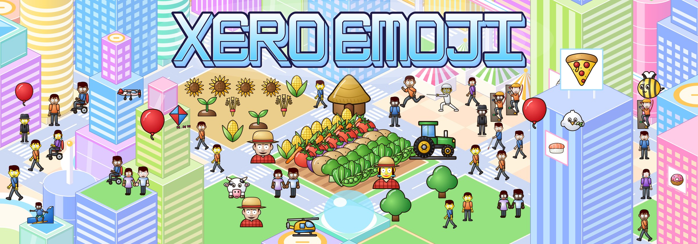](examples/banner/xero-emoji-banner.svg)

**Xero Emoji** is a complete emoji set in the Xerographer style: all **3,963** fully-qualified emoji of **Unicode Emoji 18.0**
(emoji-test 18.0), each drawn as an SVG and rendered as a 512×512 PNG. Every skin tone, ZWJ sequence, flag and keycap is included.

Xero Emoji was started in 2016. Created by maxi.grok.me.
It was first shown in public as **"Xeromoji"** in Max Infeld's
[World Emoji Day post on Steemit](https://steemit.com/emoji/@max-infeld/happy-world-emoji-day-preview-our-new-emoji-set-only-on-steemit)
(17 July 2017, @max-infeld), which presented it as "a NEW full UNICODE Emoji Font" from Xerographer Fonts. The sources and the full story are in [docs/HISTORY.md](docs/HISTORY.md).

**Live demos (GitHub Pages):** [home](https://maximusmaximus.github.io/xeroemoji/) · [gallery](https://maximusmaximus.github.io/xeroemoji/demos/) ·
[chat demo](https://maximusmaximus.github.io/xeroemoji/demos/chat.html) · [skin tones](https://maximusmaximus.github.io/xeroemoji/demos/skin-tones.html) · **How to use it:** [docs/USAGE.md](docs/USAGE.md)

[](https://github.com/maximusmaximus/xeroemoji/actions/workflows/ci.yml) [](https://www.npmjs.com/package/xeroemoji) [](https://pypi.org/project/xeroemoji/)

## Install

Xero Emoji is published as **`xeroemoji`** on [npm](https://www.npmjs.com/package/xeroemoji) and [PyPI](https://pypi.org/project/xeroemoji/). Both packages look up any emoji (including skin tones) and give you its Xero Emoji SVG or PNG link, search by name, and turn text into HTML with Xero Emoji images.

**JavaScript / Node** (needs Node 18 or newer):
```sh
npm install xeroemoji
```
```js
const xe = require('xeroemoji');
xe.get('🚀').svgUrl;              // link to the rocket SVG
xe.search('cat', { limit: 5 });   // find emoji by name
xe.variants('👋');                // the default + 5 skin tones
```
Command line, no install needed: `npx xeroemoji get 🚀`, `npx xeroemoji search pizza`, `npx xeroemoji download 🚀 png ./emoji`.

**Python** (3.9 or newer):
```sh
pip install xeroemoji
```
```python
import xeroemoji as xe
xe.get('👍🏿')['png_url']        # link to the PNG
xe.search('pizza', limit=3)     # find emoji by name
xe.emojify('hi 👋🏽')             # HTML with Xero Emoji  tags
```

Images load from the jsDelivr CDN by default. To host them yourself, download the zips from the [latest release](https://github.com/maximusmaximus/xeroemoji/releases/latest) and point the package at your copy (`xe.setBase('/static/xeroemoji/')` in JS). More details are in the [npm package guide](packages/npm/README.md), the [Python package guide](packages/python/README.md) and [docs/USAGE.md](docs/USAGE.md).

## Color emoji font

A COLRv1 color font covering all 3,963 emoji (ZWJ sequences, skin tones, flags and keycaps included) is in [`fonts/`](fonts/) and attached to the [v1.1.0 release](https://github.com/maximusmaximus/xeroemoji/releases/tag/v1.1.0). Use it on the web with no JavaScript:

```css
@font-face {
  font-family: "Xero Emoji";
  src: url("https://cdn.jsdelivr.net/gh/maximusmaximus/xeroemoji@v1.1.0/fonts/XeroEmoji-COLRv1.woff2") format("woff2"),
       url("https://cdn.jsdelivr.net/gh/maximusmaximus/xeroemoji@v1.1.0/fonts/XeroEmoji-COLRv1.ttf") format("truetype");
  font-display: swap;
}
body { font-family: system-ui, sans-serif, "Xero Emoji"; }
.emoji { font-family: "Xero Emoji"; }
```

COLRv1 is supported in Chrome, Edge and Firefox. Safari falls back to the system emoji, so use the SVGs or npm package where Safari matters. To install on a desktop, download `XeroEmoji-COLRv1.ttf` and open it. Rebuild with `tools/font/build_font.sh`.

## Example posters

Nine 18×24" posters built only from unmodified Xero Emoji SVGs. For Day City, Carnival and Harbour, click a thumbnail for the full vector SVG (15–25 MB, so it can take a moment to open). The PDFs are pinned on IPFS.

<table><tr><td align="center" width="33%"><a href="examples/posters/xero-emoji-poster-1-day-city.svg">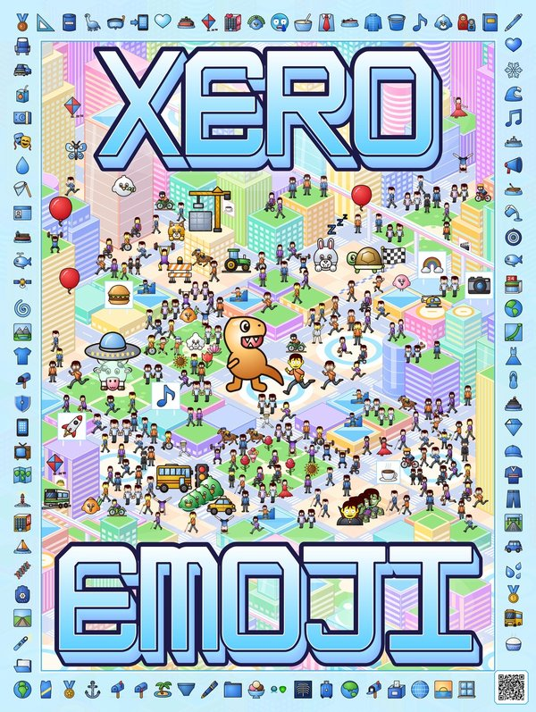</a><br><b>Day City</b><br><a href="examples/posters/xero-emoji-poster-1-day-city.svg">SVG</a> · <a href="https://gateway.pinata.cloud/ipfs/QmWTtsp5cNkPFfViiKFeVboZdUm7s8ygYHc7Xt7NYmUMyD">artwork PDF</a> <sub>(PDF, 3.6 MB — large download)</sub> · <a href="https://gateway.pinata.cloud/ipfs/QmPix2Quxq2sstuhKxcxJRqiwvoJxcx8aGpJu4BLXUsUG7">18×24 print PDF</a> <sub>(PDF, 2.6 MB — large download)</sub></td><td align="center" width="33%"><a href="examples/posters/xero-emoji-poster-2-carnival.svg">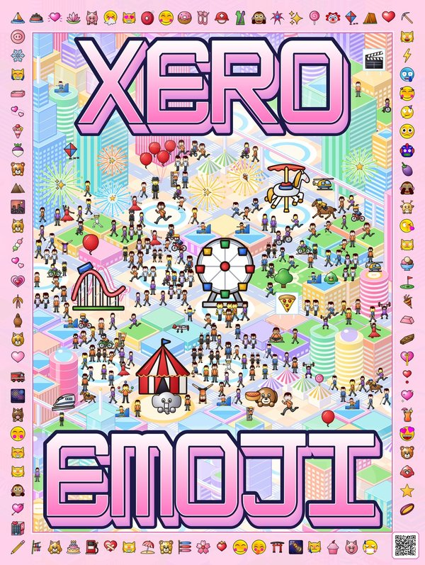</a><br><b>Carnival</b><br><a href="examples/posters/xero-emoji-poster-2-carnival.svg">SVG</a> · <a href="https://gateway.pinata.cloud/ipfs/Qmf9q9cnTCQ57PSqZknkVUMC3zwaLX7zURMJtHx982yQiV">artwork PDF</a> <sub>(PDF, 3.5 MB — large download)</sub> · <a href="https://gateway.pinata.cloud/ipfs/Qmb6zEKup4xnT5KBnCPA4ETtkWfrzDDuGwV5bjeNn6bKEz">18×24 print PDF</a> <sub>(PDF, 2.5 MB — large download)</sub></td><td align="center" width="33%"><a href="examples/posters/xero-emoji-poster-3-harbour.svg">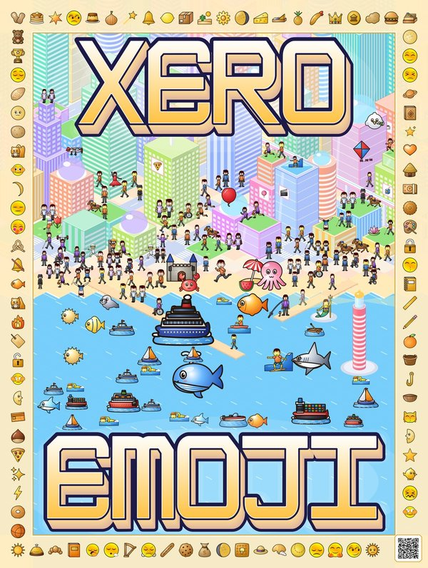</a><br><b>Harbour</b><br><a href="examples/posters/xero-emoji-poster-3-harbour.svg">SVG</a> · <a href="https://gateway.pinata.cloud/ipfs/QmcnYNdZsSWRRTnsNkoyugb55L4NLV1Co3MXMREpGfEuSb">artwork PDF</a> <sub>(PDF, 2.8 MB — large download)</sub> · <a href="https://gateway.pinata.cloud/ipfs/QmXT9h8T3qTZAFoHwsejXNBkDsoPSoGveLPh2Py2KB5bEo">18×24 print PDF</a> <sub>(PDF, 2.1 MB — large download)</sub></td></tr><tr><td align="center" width="33%"><a href="examples/posters/xero-emoji-poster-7-night-city-thumb.jpg">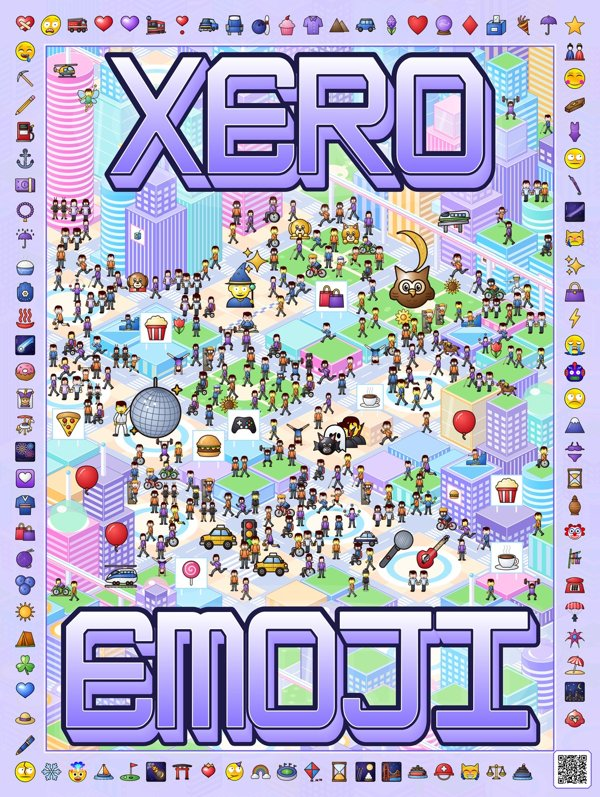</a><br><b>Night City</b><br><a href="https://gateway.pinata.cloud/ipfs/QmWyBuo22ApnB7ATo3pKtwoAxqxmNYGao8LyZSmD5nC1hH">artwork PDF</a> <sub>(PDF, 3.8 MB — large download)</sub> · <a href="https://gateway.pinata.cloud/ipfs/QmNUbeqAxbHbeBeM8bDpHpTELzUZ82nNtGyPyH2seGobER">18×24 print PDF</a> <sub>(PDF, 2.7 MB — large download)</sub></td><td align="center" width="33%"><a href="examples/posters/xero-emoji-poster-8-snow-village-thumb.jpg">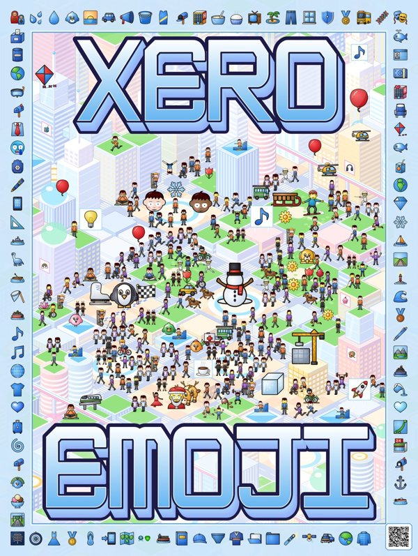</a><br><b>Snow Village</b><br><a href="https://gateway.pinata.cloud/ipfs/QmdcsZduGbpnYHir1tkwKaZ2JFCMexAQb3x3Wq8WfEV2za">artwork PDF</a> <sub>(PDF, 3.4 MB — large download)</sub> · <a href="https://gateway.pinata.cloud/ipfs/QmP1HSF9X3U8pFEr75A65Lyp6cGwHV8KwWcFf2qkFxx7ak">18×24 print PDF</a> <sub>(PDF, 2.4 MB — large download)</sub></td><td align="center" width="33%"><a href="examples/posters/xero-emoji-poster-9-beach-boardwalk-thumb.jpg">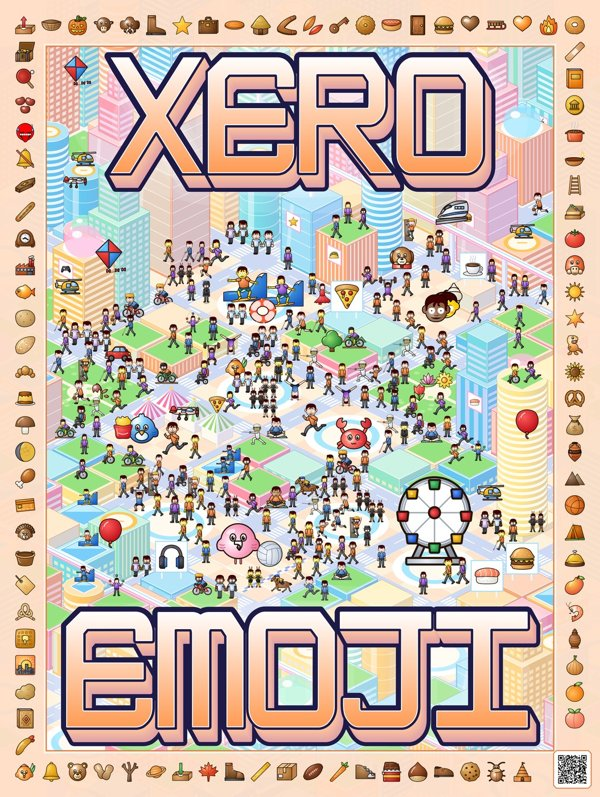</a><br><b>Beach Boardwalk</b><br><a href="https://gateway.pinata.cloud/ipfs/QmPTcACND2DL3czuRAtcxHqT7VTdEPZRtXshzp11DByD64">artwork PDF</a> <sub>(PDF, 3.8 MB — large download)</sub> · <a href="https://gateway.pinata.cloud/ipfs/QmNNgdMEzwWw9EJqKUVGu8EB7av1j2m9JEbAWULZkVW4uK">18×24 print PDF</a> <sub>(PDF, 2.7 MB — large download)</sub></td></tr><tr><td align="center" width="33%"><a href="examples/posters/xero-emoji-poster-10-garden-park-thumb.jpg">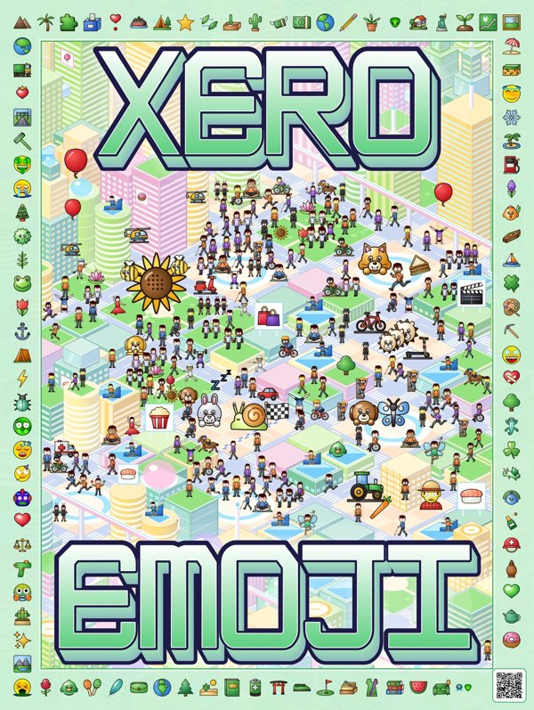</a><br><b>Garden Park</b><br><a href="https://gateway.pinata.cloud/ipfs/QmePsykhZ2eUph3mcjr8cpTBSXDGDAH3jEge9vZKr7PobZ">artwork PDF</a> <sub>(PDF, 3.6 MB — large download)</sub> · <a href="https://gateway.pinata.cloud/ipfs/QmSECEpSkHCrubk61NFUXWVYJ7ThCipurdgKfdpk3sVPh8">18×24 print PDF</a> <sub>(PDF, 2.6 MB — large download)</sub></td><td align="center" width="33%"><a href="examples/posters/xero-emoji-poster-11-market-bazaar-thumb.jpg">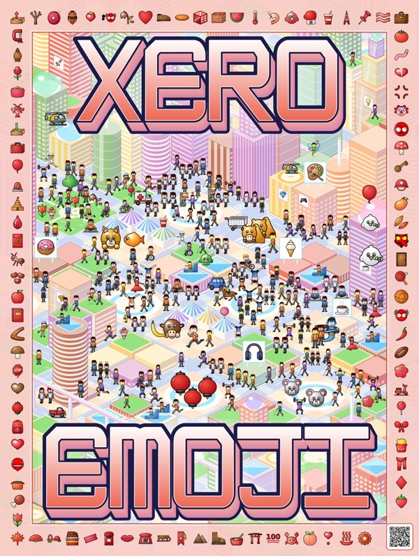</a><br><b>Market Bazaar</b><br><a href="https://gateway.pinata.cloud/ipfs/QmXcW3QbUASqiuApMS88PNkkEBVUM52wf2iJC2LbSetXQM">artwork PDF</a> <sub>(PDF, 3.7 MB — large download)</sub> · <a href="https://gateway.pinata.cloud/ipfs/Qmb5vdjw9J3MovxDTBfAKGq4Ufg7t4vBeo21nQSoAxikhZ">18×24 print PDF</a> <sub>(PDF, 2.7 MB — large download)</sub></td><td align="center" width="33%"><a href="examples/posters/xero-emoji-poster-12-space-port-thumb.jpg">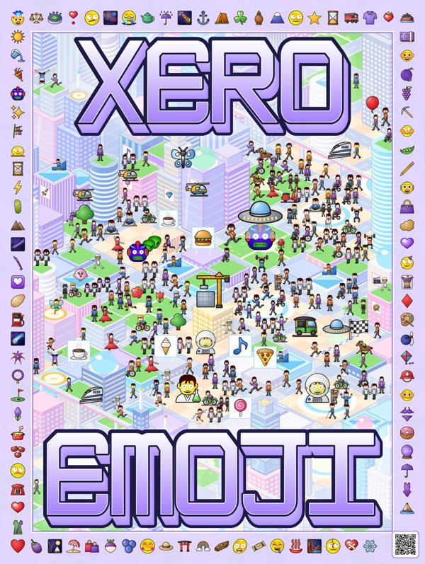</a><br><b>Space Port</b><br><a href="https://gateway.pinata.cloud/ipfs/QmUXvK4b6NBk4XtcSAmk7igzMqVhLcigFoDoaLMUuohwFS">artwork PDF</a> <sub>(PDF, 3.4 MB — large download)</sub> · <a href="https://gateway.pinata.cloud/ipfs/QmSQadmwgKaXTVZALtxobboinuPJKk8cn1guep5ZLS5FiB">18×24 print PDF</a> <sub>(PDF, 2.5 MB — large download)</sub></td></tr></table>

**App tooling:** [live demo site](https://maximusmaximus.github.io/xeroemoji/) · [gallery](https://maximusmaximus.github.io/xeroemoji/demos/) · [chat replacer demo](https://maximusmaximus.github.io/xeroemoji/demos/chat.html) ([`xero-emoji.js`](demos/xero-emoji.js)) · [skin-tone tool](https://maximusmaximus.github.io/xeroemoji/demos/skin-tones.html) · [MCP server](mcp/README.md) · [npm package](https://www.npmjs.com/package/xeroemoji) · [Python package](https://pypi.org/project/xeroemoji/) · [latest release](https://github.com/maximusmaximus/xeroemoji/releases/latest) · [CDN usage](#for-app-developers) · [usage guide](docs/USAGE.md)


### Xero Worlds cover posters (no glow)

The cover art from the *Xero Worlds* book as posters, with no glow on the text. Click a preview for the print PDF pinned on IPFS.

<table><tr><td align="center"><a href="https://gateway.pinata.cloud/ipfs/QmaSwnsJkwKxPwmS3b8fRHtGWEyJ8PUe1uPRKPcA22tHQ4">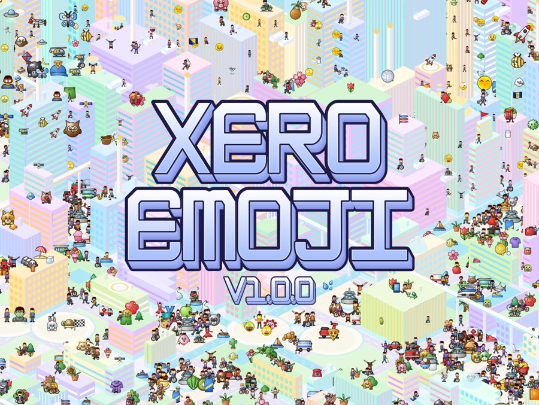</a> <sub>(PDF, 9.9 MB — large download)</sub><br><b>Horizontal 24×18</b><br><a href="https://gateway.pinata.cloud/ipfs/QmaSwnsJkwKxPwmS3b8fRHtGWEyJ8PUe1uPRKPcA22tHQ4">print PDF</a> <sub>(PDF, 9.9 MB — large download)</sub></td><td align="center"><a href="https://gateway.pinata.cloud/ipfs/Qmas1B3ZE7StRBbMiPLeZKoRyjkHBdpoUwvqoDoMCu2DPw">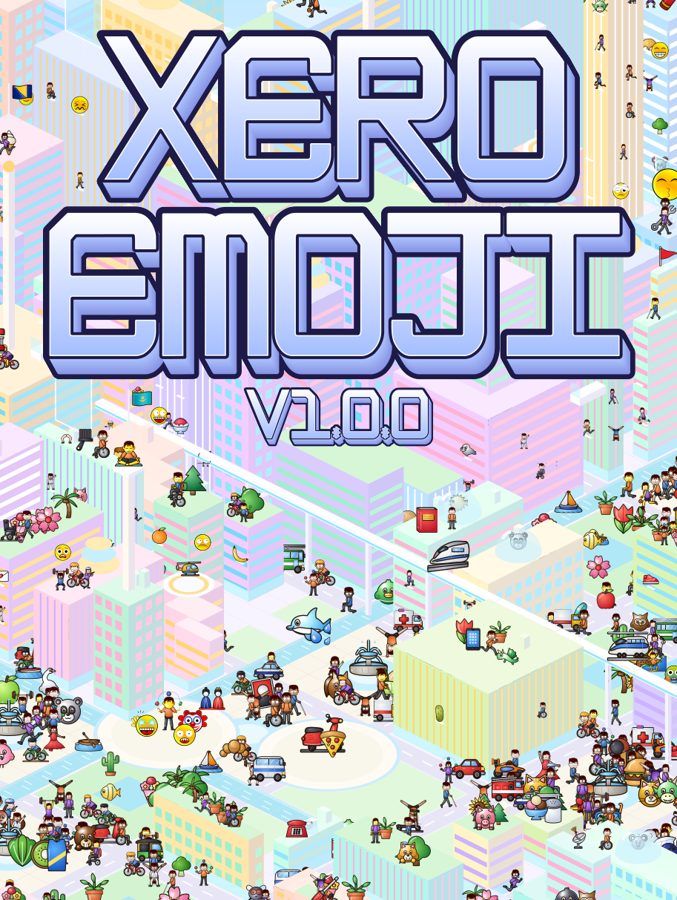</a> <sub>(PDF, 9.9 MB — large download)</sub><br><b>Vertical 18×24</b><br><a href="https://gateway.pinata.cloud/ipfs/Qmas1B3ZE7StRBbMiPLeZKoRyjkHBdpoUwvqoDoMCu2DPw">print PDF</a> <sub>(PDF, 9.9 MB — large download)</sub></td></tr></table>

## For app developers

All examples use the stable URLs below. Pin `@v1.0.0` in production; `@latest` follows the newest release.

**1. One image from the CDN** (jsDelivr, served straight from this repo):
```html


```

**2. Turn every emoji on a page into Xero Emoji** (about 5 KB of JS, no build step):
```html
<script src="https://cdn.jsdelivr.net/gh/maximusmaximus/xeroemoji@v1.0.0/demos/xero-emoji.js"></script>
<script>
  XeroEmoji.load({ base: 'https://cdn.jsdelivr.net/gh/maximusmaximus/xeroemoji@v1.0.0/' })
    .then(X => X.parse(document.body));   // or: el.innerHTML = X.toHTML('Ship it 🚀👍🏽')
</script>
<style>img.xero-emoji { width: 1.35em; height: 1.35em; vertical-align: -0.3em; }</style>
```

**3. Download the whole set** from the [latest release](https://github.com/maximusmaximus/xeroemoji/releases/latest):

| asset | contents | size |
|---|---|---|
| [`xeroemoji-svg.zip`](https://github.com/maximusmaximus/xeroemoji/releases/latest/download/xeroemoji-svg.zip) | 3,963 SVG | 24 MiB |
| [`xeroemoji-png-512.zip`](https://github.com/maximusmaximus/xeroemoji/releases/latest/download/xeroemoji-png-512.zip) | 3,963 PNG 512×512 | 244 MiB |
| [`xeroemoji-png-128.zip`](https://github.com/maximusmaximus/xeroemoji/releases/latest/download/xeroemoji-png-128.zip) | 3,963 PNG 128×128 | 56 MiB |
| [`xeroemoji-png-72.zip`](https://github.com/maximusmaximus/xeroemoji/releases/latest/download/xeroemoji-png-72.zip) | 3,963 PNG 72×72 | 25 MiB |
| [`emoji-map.json`](https://github.com/maximusmaximus/xeroemoji/releases/latest/download/emoji-map.json) · [`xero-emoji.js`](https://github.com/maximusmaximus/xeroemoji/releases/latest/download/xero-emoji.js) · [`SHA256SUMS.txt`](https://github.com/maximusmaximus/xeroemoji/releases/latest/download/SHA256SUMS.txt) | map, replacer, checksums | |

```bash
curl -fLO https://github.com/maximusmaximus/xeroemoji/releases/latest/download/xeroemoji-svg.zip && unzip -q xeroemoji-svg.zip   # -> xeroemoji/svg/*.svg
```
Every zip also contains `emoji-map.json`, `LICENSE` and `COMMERCIAL-LICENSE.md`.

**4. npm** (package prepared, *not published to npm yet*; for now install the release tarball):
```bash
npm install https://github.com/maximusmaximus/xeroemoji/releases/download/v1.0.0/xeroemoji-1.0.0.tgz
npx xeroemoji get 👍🏿          # metadata + URLs; also: search cat · variants 👋 · download 🚀 png ./emoji
```
```js
const xe = require('xeroemoji');           // ships only the emoji map (440 KB); images come from the CDN
xe.get('👩🏽‍🚀').svgUrl                     // https://cdn.jsdelivr.net/gh/maximusmaximus/xeroemoji@v1.0.0/svg/1f469-1f3fd-200d-1f680.svg
xe.search('cat', { limit: 5 }); xe.variants('👋'); xe.setBase('/static/xeroemoji/');   // self-host after unzipping
```

**5. React**
```jsx
import { get } from 'xeroemoji';
export function Emoji({ e, size = 24 }) {
  const x = get(e);
  return x ?  : <span>{e}</span>;
}
// <p>Launch day <Emoji e="🚀" /> <Emoji e="👍🏾" size={32} /></p>
```

**6. Python** (no dependencies; *not on PyPI yet*):
```bash
pip install https://github.com/maximusmaximus/xeroemoji/releases/download/v1.0.0/xeroemoji-1.0.0-py3-none-any.whl
python -m xeroemoji get 🐙     # also: search, variants, emojify, download, mcp
```
```python
import xeroemoji as xe
xe.get('🐙')['png_url']; xe.search('pizza', limit=3); xe.emojify('hi 👋🏽')   # -> HTML with  tags
```

**7. iOS, Android, Flutter**: bundle the PNGs and load them by file name.
- **iOS:** unzip `png-72` (24 pt @3x) or `png-128` into the app bundle or an asset catalog, then use `UIImage(named: "1f680")`.
- **Android:** use `assets/xeroemoji/` and open files with `assets.open("xeroemoji/1f680.png")`. Not `res/drawable`, because resource names cannot start with a digit or contain `-`.
- **Flutter:**
  - Pure PNG: list `assets/xeroemoji/png-72/` under `flutter: assets:`, then `Image.asset('assets/xeroemoji/png-72/1f680.png')`.
  - SVG: use `flutter_svg` with the SVGs, and check the gradients render.
- **Keyboard or picker UI:** use `emoji-map.json` for names, groups and ordering.
- **App size:** ship only the subset you need. All 3,963 PNGs at 72 px are 25 MiB.

**8. Naming convention**: `svg/<name>.svg` and `png/<name>.png`. `<name>` is the codepoints in lowercase hex, at least 4 digits, joined by `-`.

| emoji | rule | file |
|---|---|---|
| 😀 | single codepoint | `1f600` |
| ❤️ | U+FE0F is dropped | `2764` |
| #️⃣ | keycap: FE0F dropped, padded to 4 digits | `0023-20e3` |
| 👍🏿 | skin tone right after the base | `1f44d-1f3ff` |
| 👩🏽‍🚀 | ZWJ sequence, `200d` kept | `1f469-1f3fd-200d-1f680` |
| 🧑🏻‍🤝‍🧑🏿 | one tone per person | `1f9d1-1f3fb-200d-1f91d-200d-1f9d1-1f3ff` |
| 🇯🇵 | flag = 2 regional indicators | `1f1ef-1f1f5` |
| 🏳️‍🌈 🏳️‍⚧️ 🏴‍☠️ ⛓️‍💥 | FE0F dropped here too, no exceptions | `1f3f3-200d-1f308`, `1f3f3-200d-26a7`, `1f3f4-200d-2620`, `26d3-200d-1f4a5` |

The easiest lookup is `emoji-map.json`. Its keys are the codepoints with FE0F removed, so text with or without variation selectors finds the same entry. The value is `[file, emoji, name, group, subgroup, order]`.

**9. License**: the artwork is **CC BY-NC 4.0**. Credit "Xero Emoji by Max Infeld" and link this repo. **Commercial use needs a license**: contact maxinfeld@gmail.com (see [COMMERCIAL-LICENSE.md](COMMERCIAL-LICENSE.md)).

**For AI agents:** see [AGENTS.md](AGENTS.md), [llms.txt](llms.txt) and the [MCP server](mcp/README.md), which offers `search_emoji`, `get_emoji`, `list_categories`, `get_skin_tone_variants` and `emojify_text`.

**License:** artwork under [CC BY-NC 4.0](LICENSE); for commercial licensing, contact maxinfeld@gmail.com (see [COMMERCIAL-LICENSE.md](COMMERCIAL-LICENSE.md)).

### House style
- **Look:** thick black outlines, glossy gradient fills, big white eyes, and open mouths with a shaded bowl.
- **People:** front-facing heads with matched hands, built on a shared body skeleton. Hats are fitted to the head.
- **Skin tones:** one 5-tone palette used across the whole set.
- **Small sizes:** every figure is checked to read at 32 and 24 px.

### Quality control
Every file is scored by the bundled checker [`qc/xeroqc`](qc/xeroqc) against the codified house requirements in [`qc/REQUIREMENTS.md`](qc/REQUIREMENTS.md): 29 scored per emoji, 4 set-level and 4 manual. It also verifies an md5 lock for every approved file.
Latest run: **3,386 PASS · 577 PASS-with-known-exceptions · 0 FAIL** (mean score 99.92).

### Showcase
| | |
|---|---|
| 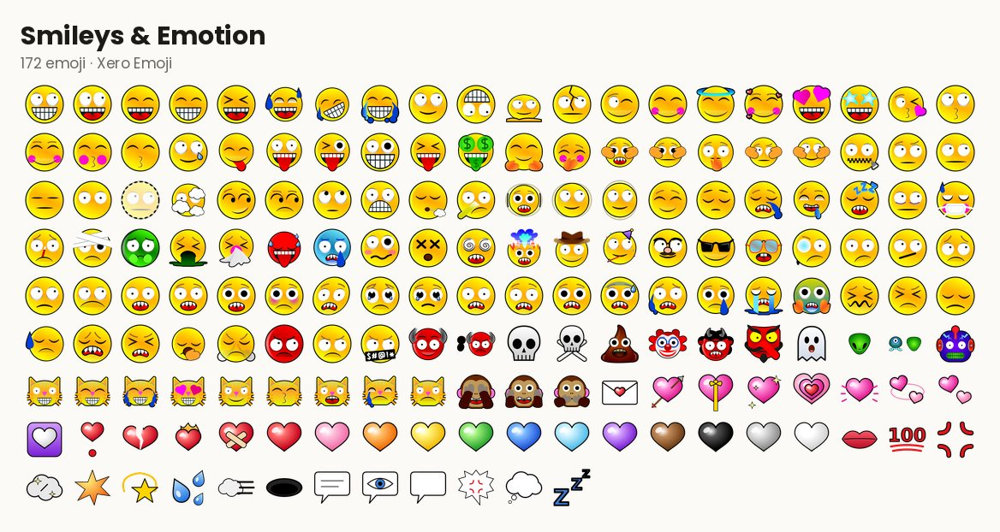 | 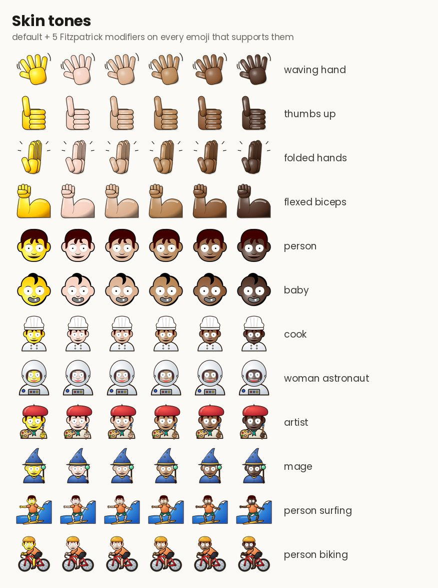 |
| 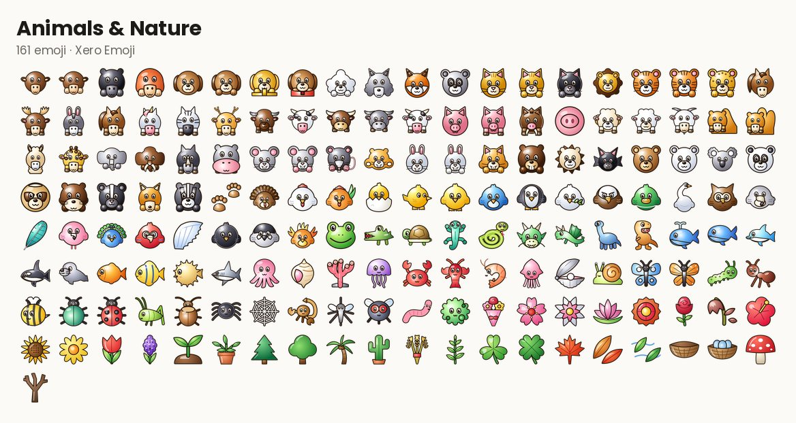 | 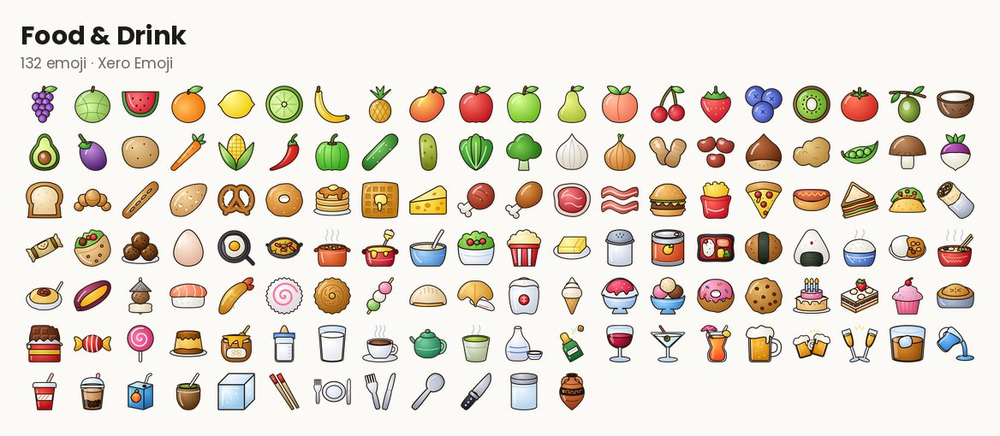 |

More contact sheets: [people](docs/images/people.jpg) · [travel](docs/images/travel.jpg) · [activities](docs/images/activities.jpg) · [objects](docs/images/objects.jpg) · [symbols](docs/images/symbols.jpg) · [flags](docs/images/flags.jpg)
(rendered from the approved PNGs by `tools/make_showcase.py`).

## Demo project

**[Xero Emoji World](https://github.com/maximusmaximus/xero-emoji-world)** is a live, isometric 3D city built entirely from the Xero Emoji set: buildings, villagers, trees and props are all emoji from this repo.

**Live:** https://xeroemoji.grok.me

[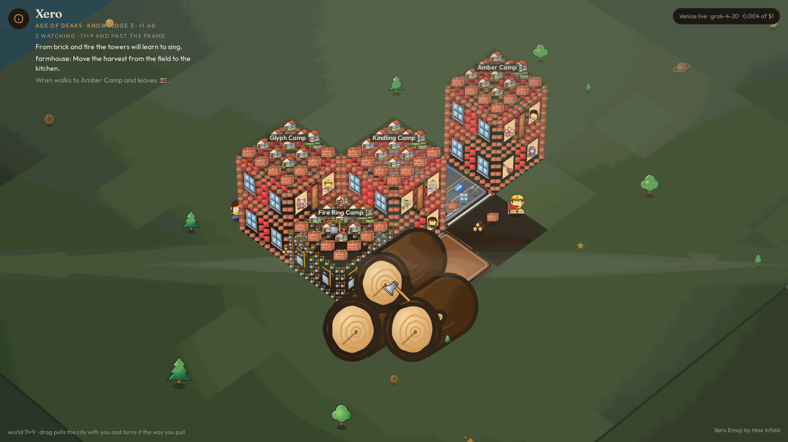](https://xeroemoji.grok.me)

## Promotion materials

Paste-ready announcements and banners are in [`promo/`](promo/):

- [X post](promo/x-announcement.txt)
- [Signal message](promo/signal-announcement.txt)
- [Instagram banner, 1080×1350](promo/instagram-xero-world-banner.png) and [square, 1080×1080](promo/instagram-xero-world-banner-square.png)
- [Instagram caption](promo/instagram-caption.txt)
- Xero Worlds cover posters, no glow: [horizontal 24×18 PDF](https://gateway.pinata.cloud/ipfs/QmaSwnsJkwKxPwmS3b8fRHtGWEyJ8PUe1uPRKPcA22tHQ4) <sub>(PDF, 9.9 MB — large download)</sub> · [vertical 18×24 PDF](https://gateway.pinata.cloud/ipfs/Qmas1B3ZE7StRBbMiPLeZKoRyjkHBdpoUwvqoDoMCu2DPw) <sub>(PDF, 9.9 MB — large download)</sub> ([previews](#xero-worlds-cover-posters-no-glow))
- Instagram Stories, 1080×1920: [Day City](promo/stories/xero-emoji-story-1-day-city.png) · [Carnival](promo/stories/xero-emoji-story-2-carnival.png) · [Harbour](promo/stories/xero-emoji-story-3-harbour.png)

Links: [GitHub](https://github.com/maximusmaximus/xeroemoji) · [Xero Emoji World](https://xeroemoji.grok.me)

[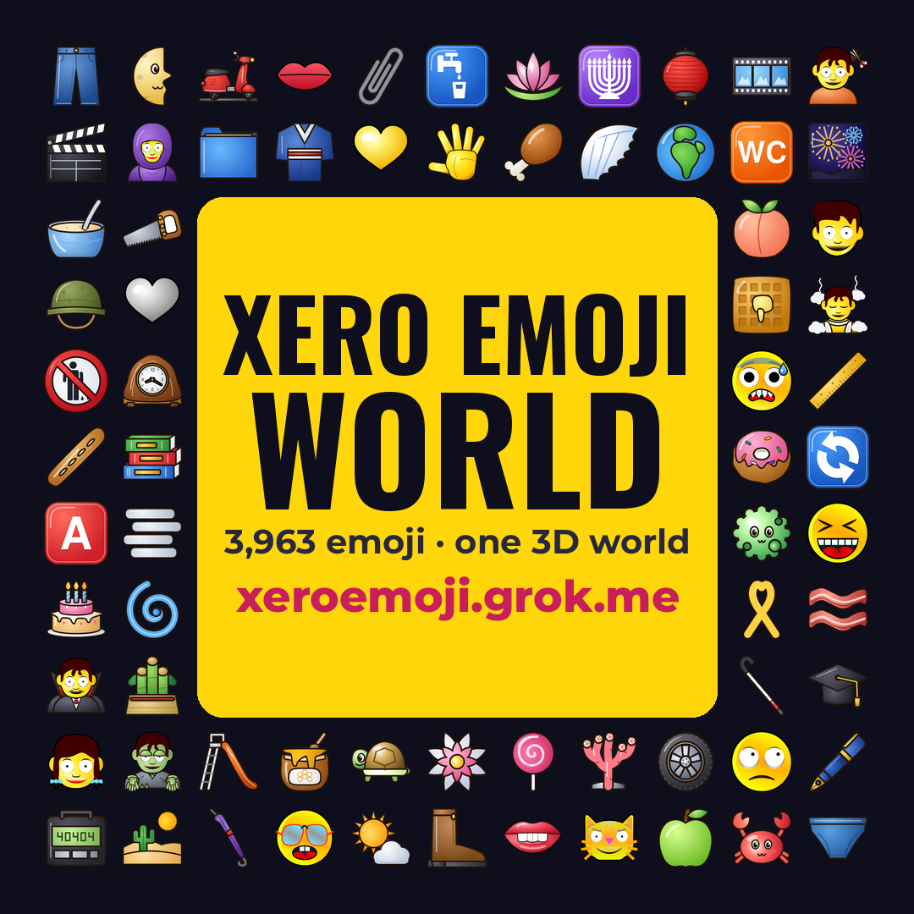](promo/README.md)

<p>
<a href="promo/stories/xero-emoji-story-1-day-city.png">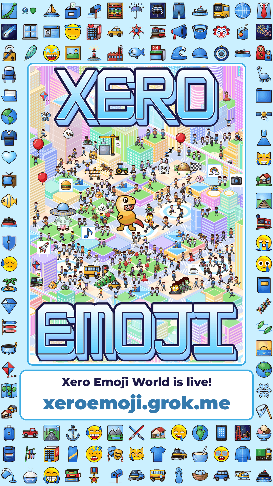</a>
<a href="promo/stories/xero-emoji-story-2-carnival.png">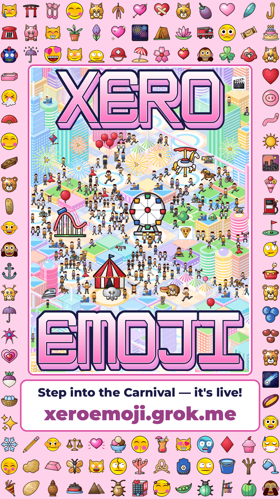</a>
<a href="promo/stories/xero-emoji-story-3-harbour.png">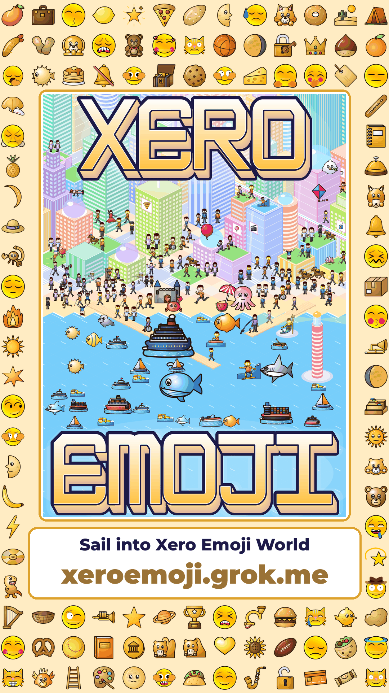</a>
</p>

## Black line set
A monochrome version of all 3,963 emoji: black outlines, a white fill and a transparent outside. There is no colour and no
grey. Use it as a fallback where colour emoji don't fit, as a light or print-friendly set, for colouring pages, or
anywhere you need one-colour icons.

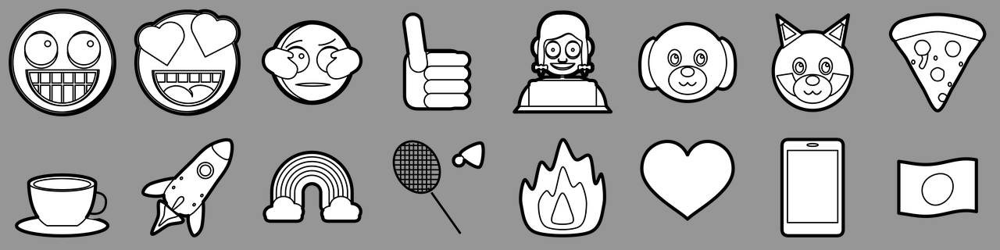

**Files** (in [`blackline/`](blackline)). The file names match `svg/` and `png/` exactly (codepoints, FE0F dropped),
so you can swap the folder in any path or URL:
| path | contents |
|---|---|
| `blackline/svg/<name>.svg` | 3,963 SVGs, 512×512 viewBox, each one white path and one black path |
| `blackline/png/<name>.png` | 512×512 RGBA renders |
| `blackline/png-72/<name>.png` | 72×72 renders with heavier lines for small sizes |
| `blackline/emoji-map.json` | the same emoji → file map as `demos/emoji-map.json` |

**Get it**
- Whole repo: `git clone https://github.com/maximusmaximus/xeroemoji.git`
- Only the black line folder:
  ```
  git clone --filter=blob:none --sparse https://github.com/maximusmaximus/xeroemoji.git
  cd xeroemoji && git sparse-checkout set blackline
  ```
- Single files: `https://raw.githubusercontent.com/maximusmaximus/xeroemoji/main/blackline/svg/1f600.svg`, or the
  CDN `https://cdn.jsdelivr.net/gh/maximusmaximus/xeroemoji@main/blackline/png/1f600.png` (the black line set isn't in the v1.0.0 release, so use `@main`).
- The npm and Python packages return colour URLs only. To get the black line file, replace `svg/` or `png/` in the
  path they return with `blackline/svg/` or `blackline/png/`.

**Regenerate and validate** with [`tools/blackline`](tools/blackline) (see its `README.md` and `PIPELINE.md`):
```
cd tools/blackline && pip install -r requirements.txt && bash tools/get_potrace.sh   # or set POTRACE
python3 pipeline.py build --engine vector --src ../../svg --out /tmp/blv --map ../../demos/emoji-map.json
python3 pipeline.py build --engine raster --src ../../svg --out /tmp/blr --map ../../demos/emoji-map.json
python3 pipeline.py check --build /tmp/blv --src ../../svg --out /tmp/blv-qc    # line weight, density, fidelity, topology, structure
python3 xray_test.py --build /tmp/blv --log /tmp/blv/build-log.json --out /tmp/blv-xray
python3 -m pytest -q                                                            # sheet labels + golden regression, both engines
```
The published set is the v6-final selection: the vector engine's output where it passes every check and the x-ray
test, otherwise the raster engine's (16 emoji). Results: x-ray 0 failures, rule checks 0 failures (1 reviewed waiver,
listed in `golden/reviewed.json`), spec audit 10/10. To keep the repo small, the published SVGs were simplified
with no visible change: points within 0.12px were dropped and coordinates rounded to 0.1px, and every file renders
≥ 99.99% identical to the unsimplified output.

## Layout
| path | contents |
|---|---|
| `svg/` | 3,963 SVG files, named by codepoints (lowercase hex joined by `-`, FE0F dropped except 4 names), e.g. `1f600.svg`, `1f469-1f3fd-200d-1f680.svg` |
| `png/` | 3,963 PNG renders of the SVGs, 512×512 RGBA, same names |
| `blackline/` | the black line set: `svg/`, `png/` (512), `png-72/`, `emoji-map.json` (see [Black line set](#black-line-set)) |
| `qc/REQUIREMENTS.md` | the codified house requirements (29 scored per emoji, 4 set-level, 4 manual) |
| `qc/xeroqc/` | the QC scorer (`python3 -m xeroqc run`), version 1.0.0 |
| `qc/tests/` | unit tests for the scorer |
| `qc/checkers/` | the checkers xeroqc reuses (check.py, hlaudit, hatfit, posecheck, skel9, mouthbowl, people_qc), as of this snapshot |
| `qc/results/` | the latest full QC run (results.json/.csv, summary.md, report.html, tests.log) and evidence files |
| `qc/locks/` + `qc/verify_locks.sh` | the 75 approved lock manifests (md5 of every file) |
| `qc/*.json` | house spec, skin tones, known-exception lists |
| `qc/coverage.csv` | the Unicode emoji-test 18.0 coverage list the set is checked against (3,963 entries) |
| `qc/FINAL-SET-STATUS-*.md` | the current whole-set status |
| `demos/` | GitHub Pages demos (gallery, chat, skin tones), `xero-emoji.js` replacer and `emoji-map.json` |
| `docs/` | `USAGE.md`, `HISTORY.md` (sources), showcase images |
| `tools/` | `build_emoji_map.py`, `build_release.py` (release assets), `make_showcase.py`, `ci/release.yml`, `blackline/` (black line pipeline + tests) |
| `packages/` | `python/` (lib + CLI + MCP server) and `npm/` (lib + CLI), prepared, not published to registries |
| `mcp/` | MCP server for AI agents and IDEs |
| `AGENTS.md`, `llms.txt` | guides for coding agents and LLMs |

## QC details
Latest run (2026-10-18 12:24 PT, xeroqc 1.0.0): 3,386 PASS, 577 PASS-with-known-exceptions, 0 FAIL; mean score 99.92.
Set checks: coverage 3,963/3,963, no duplicates or orphans, 75/75 locks verify. See `qc/results/20261018-1224PT/summary.md`
and `qc/FINAL-SET-STATUS-*.md`.

Run it from the repo: `cd qc && python3 -m xeroqc run` (results go to `qc/results/<timestamp>PT/`; `--out DIR` to write elsewhere),
tests: `cd qc && python3 -m unittest discover -s tests`, locks: `bash qc/verify_locks.sh`. Paths resolve from the repo layout
(override with `XEROQC_SET` and `XEROQC_COVERAGE`). Needs Python 3 with numpy, Pillow, cairosvg, scikit-image, imagehash.

## License
Licensed under CC BY-NC 4.0 for non-commercial use. For commercial licensing, contact maxinfeld@gmail.com
