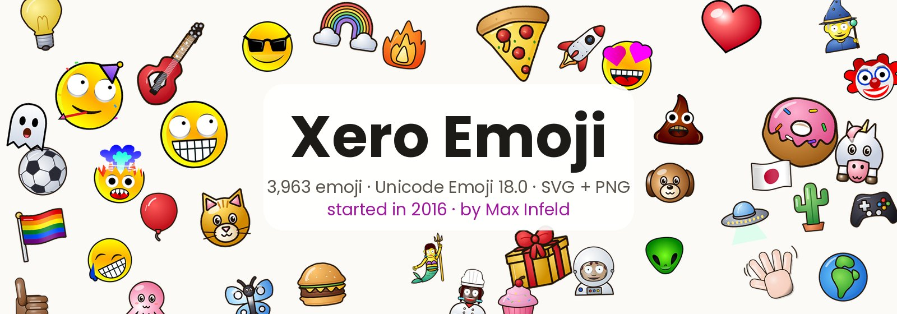

# Xero Emoji



**Xero Emoji** is a complete emoji set in the Xerographer style: all **3,963** fully-qualified emoji of **Unicode Emoji 18.0**
(emoji-test 18.0), each drawn as an SVG and rendered as a 512×512 PNG. Every skin tone, ZWJ sequence, flag and keycap is included.

Xero Emoji was started in 2016. Created by maxi.grok.me.
It was first shown in public as **"Xeromoji"** in Max Infeld's
[World Emoji Day post on Steemit](https://steemit.com/emoji/@max-infeld/happy-world-emoji-day-preview-our-new-emoji-set-only-on-steemit)
(17 July 2017, @max-infeld), which presented it as "a NEW full UNICODE Emoji Font" from Xerographer Fonts. The sources and the full story are in [docs/HISTORY.md](docs/HISTORY.md).

**Live demos (GitHub Pages):** [home](https://maximusmaximus.github.io/xeroemoji/) · [gallery](https://maximusmaximus.github.io/xeroemoji/demos/) ·
[chat demo](https://maximusmaximus.github.io/xeroemoji/demos/chat.html) · [skin tones](https://maximusmaximus.github.io/xeroemoji/demos/skin-tones.html) · **How to use it:** [docs/USAGE.md](docs/USAGE.md)

**License:** artwork under [CC BY-NC 4.0](LICENSE); commercial use needs a separate license, see [COMMERCIAL-LICENSE.md](COMMERCIAL-LICENSE.md).

### House style
- **Look:** thick black outlines, glossy gradient fills, big white eyes, and open mouths with a shaded bowl.
- **People:** front-facing heads with matched hands, built on a shared body skeleton. Hats are fitted to the head.
- **Skin tones:** one 5-tone palette used across the whole set.
- **Small sizes:** every figure is checked to read at 32 and 24 px.

### Quality control
Every file is scored by the bundled checker [`qc/xeroqc`](qc/xeroqc) against the codified house requirements in [`qc/REQUIREMENTS.md`](qc/REQUIREMENTS.md): 29 scored per emoji, 4 set-level and 4 manual. It also verifies an md5 lock for every approved file.
Latest run: **3,386 PASS · 577 PASS-with-known-exceptions · 0 FAIL** (mean score 99.92).

### Showcase
| | |
|---|---|
|  |  |
|  |  |

More contact sheets: [people](docs/images/people.jpg) · [travel](docs/images/travel.jpg) · [activities](docs/images/activities.jpg) · [objects](docs/images/objects.jpg) · [symbols](docs/images/symbols.jpg) · [flags](docs/images/flags.jpg)
(rendered from the approved PNGs by `tools/make_showcase.py`).

### Quick start
```html

<script src="https://maximusmaximus.github.io/xeroemoji/demos/xero-emoji.js"></script>
<script>XeroEmoji.load({ base: 'https://maximusmaximus.github.io/xeroemoji/' }).then(X => X.parse(document.body));</script>
```

## Layout
| path | contents |
|---|---|
| `svg/` | 3,963 SVG files, named by codepoints (lowercase hex joined by `-`, FE0F dropped except 4 names), e.g. `1f600.svg`, `1f469-1f3fd-200d-1f680.svg` |
| `png/` | 3,963 PNG renders of the SVGs, 512×512 RGBA, same names |
| `qc/REQUIREMENTS.md` | the codified house requirements (29 scored per emoji, 4 set-level, 4 manual) |
| `qc/xeroqc/` | the QC scorer (`python3 -m xeroqc run`), version 1.0.0 |
| `qc/tests/` | unit tests for the scorer |
| `qc/checkers/` | the checkers xeroqc reuses (check.py, hlaudit, hatfit, posecheck, skel9, mouthbowl, people_qc), as of this snapshot |
| `qc/results/` | the latest full QC run (results.json/.csv, summary.md, report.html, tests.log) and evidence files |
| `qc/locks/` + `qc/verify_locks.sh` | the 75 approved lock manifests (md5 of every file) |
| `qc/*.json` | house spec, skin tones, known-exception lists |
| `qc/coverage.csv` | the Unicode emoji-test 18.0 coverage list the set is checked against (3,963 entries) |
| `qc/FINAL-SET-STATUS-*.md` | the current whole-set status |
| `demos/` | GitHub Pages demos (gallery, chat, skin tones), `xero-emoji.js` replacer and `emoji-map.json` |
| `docs/` | `USAGE.md`, `HISTORY.md` (sources), showcase images |
| `tools/` | `build_emoji_map.py`, `make_showcase.py` |

## QC details
Latest run (2026-10-18 12:24 PT, xeroqc 1.0.0): 3,386 PASS, 577 PASS-with-known-exceptions, 0 FAIL; mean score 99.92.
Set checks: coverage 3,963/3,963, no duplicates or orphans, 75/75 locks verify. See `qc/results/20261018-1224PT/summary.md`
and `qc/FINAL-SET-STATUS-*.md`.

Run it from the repo: `cd qc && python3 -m xeroqc run` (results go to `qc/results/<timestamp>PT/`; `--out DIR` to write elsewhere),
tests: `cd qc && python3 -m unittest discover -s tests`, locks: `bash qc/verify_locks.sh`. Paths resolve from the repo layout
(override with `XEROQC_SET` and `XEROQC_COVERAGE`). Needs Python 3 with numpy, Pillow, cairosvg, scikit-image, imagehash.

## License
The artwork is licensed under **Creative Commons Attribution-NonCommercial 4.0 International (CC BY-NC 4.0)**, see `LICENSE`.
Commercial use needs a separate license, see `COMMERCIAL-LICENSE.md`.
