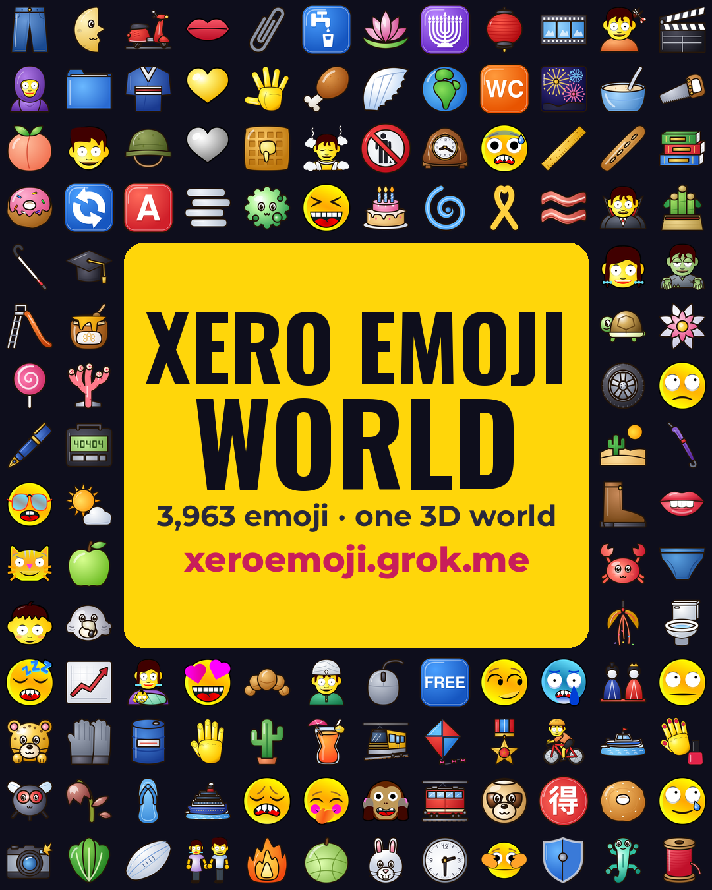

# Xero Emoji promotion materials

- Live 3D world: https://xeroemoji.grok.me
- GitHub: https://github.com/maximusmaximus/xeroemoji

Every border uses single-codepoint emoji only (no ZWJ, skin-tone or variation-selector sequences), and lines are kept short so they don't wrap on phones.

## X (Twitter) post — [x-announcement.txt](x-announcement.txt)

224 / 280 weighted characters (checked with `twitter-text`).

```text
✨🚀✨🚀✨🚀✨🚀✨
😀 XERO EMOJI is live 😀
🎨 3,963 emoji, 1 set 🎨
📦 npm + PyPI
🔤 COLRv1 color font
🔍 Gallery + picker
🌍 Explore the 3D world:
https://xeroemoji.grok.me
💻 Code:
https://github.com/maximusmaximus/xeroemoji
✨🚀✨🚀✨🚀✨🚀✨
```

## Signal message — [signal-announcement.txt](signal-announcement.txt)

```text
🌈🌈🌈🌈🌈🌈🌈🌈🌈🌈🌈
✨ XERO EMOJI is here ✨
🌈🌈🌈🌈🌈🌈🌈🌈🌈🌈🌈

😀 3,963 emoji, 1 style 😀
🎨 Every emoji redrawn 🎨

📦 npm install xeroemoji
🐍 pip install xeroemoji

🔤 COLRv1 color font
🔤 TTF + WOFF2 builds

🔍 Searchable gallery
👆 Drop-in emoji picker

🌍 Walk the 3D world 🌍
https://xeroemoji.grok.me

💻 Source + docs 💻
https://github.com/maximusmaximus/xeroemoji

🚀 Try it, star it, share 🚀
🌈🌈🌈🌈🌈🌈🌈🌈🌈🌈🌈
```

## Instagram banner

Portrait 1080×1350 — [instagram-xero-world-banner.png](instagram-xero-world-banner.png)



Square 1080×1080 — [instagram-xero-world-banner-square.png](instagram-xero-world-banner-square.png)


### Caption — [instagram-caption.txt](instagram-caption.txt)

Instagram captions don't make links clickable, so put https://xeroemoji.grok.me in your bio.

```text
✨ Welcome to XERO EMOJI WORLD ✨

😀 3,963 emoji, all redrawn in one style
🌍 Wander through them in a live 3D world
📦 Free on npm + PyPI
🔤 COLRv1 color font (TTF + WOFF2)
🔍 Searchable gallery + emoji picker

🔗 Link in bio: xeroemoji.grok.me
💻 Code: github.com/maximusmaximus/xeroemoji

#xeroemoji #emoji #emojiart #3dworld #webdev #opensource #fonts #colorfont #javascript #python #design #typography
```
